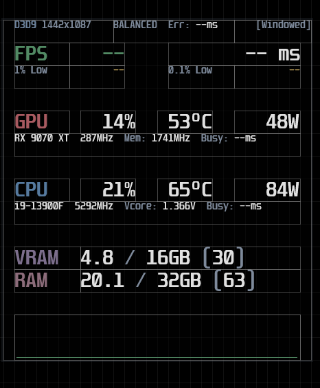

# RTSS-PresentMon-MangoHud

<p align="center">
  
</p>

A refined, eye-friendly, low-saturation MangoHud-style overlay layout for **RivaTuner Statistics Server (RTSS)** featuring **Intel PresentMon 2.0** telemetry.

---

## 🌟 Features

- **Matte Eye-Friendly Palette**: Muted Nordic/Morandi tones (soft sage green `#528A64` for FPS, warm sand `#B89C58` for 1% Low, brick red & slate blue for hardware vendors, soft off-white `#E0E0E0` for values). Non-glaring in dark environments.
- **Standalone RTSS Native**: No HWiNFO64 or AIDA64 required in the background. VRAM clock and CPU Vcore voltage are streamed directly through RTSS native HAL and the built-in `LHMDataProvider`.
- **Intel PresentMon 2.0 Metrics**:
  - Hardware bottleneck detection: `GPU BOUND`, `CPU BOUND`, or `BALANCED`.
  - Display timing: `Animation Error` (ms).
  - Presentation mode: `[Direct Flip]` or `[Windowed]`.
- **Clean Grid Typography**: Symmetrical dual-column right-aligned 1% Low and 0.1% Low frame rates.
- **Frametime Graph**: Inset bottom history graph with neat margins.

---

## 🚀 Quick Start

1. Download [`presentmon_mangohud.ovl`](./presentmon_mangohud.ovl).
2. Copy it to your RTSS overlays directory (or load it from anywhere):
   ```text
   C:\Program Files (x86)\RivaTuner Statistics Server\Plugins\Client\Overlays\
   ```
3. Open RTSS -> Click **Setup** -> Go to **Plugins** tab -> Enable and double-click `OverlayEditor.dll`.
4. In OverlayEditor, click **Layout** -> **Load** -> select `presentmon_mangohud.ovl`.
5. Click **Layout** -> **Save** and minimize. Enjoy!

---

## 📄 License

MIT
